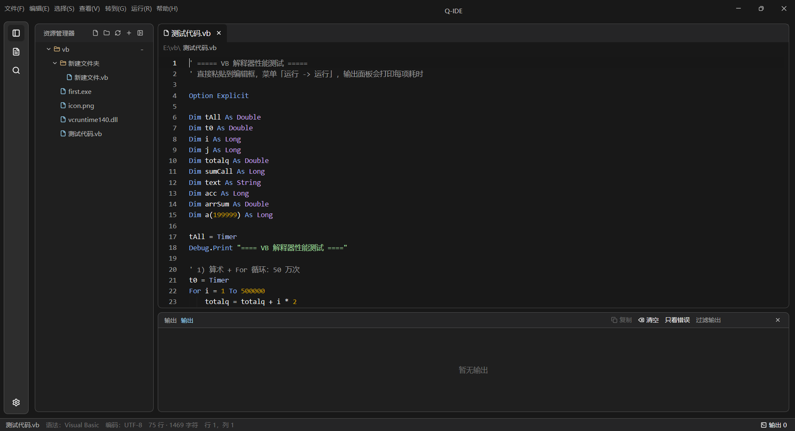
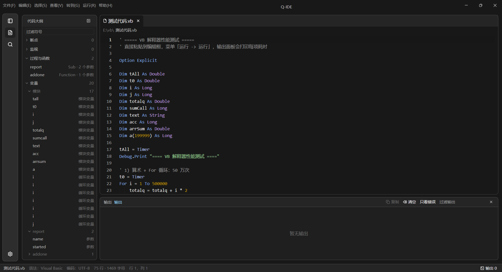

# Q-IDE

用 Rust + GPUI（`gpui` / `gpui-kit`）写的 Windows 桌面代码编辑器，内置一个 **VB6/VBA 风格脚本解释器**：用 VB 语法写小脚本、`Declare` 直接调用 Win32 API，并在编辑器里打断点、单步、看变量。

界面文案为中文，当前版本 `0.1.0`，只在 Windows 后端构建验证过。许可证：[MIT](LICENSE)。

## 界面预览

自绘标题栏与菜单、资源管理器、VB 语法高亮、底部输出面板与状态栏：



代码大纲面板：按「断点 / 监视 / 过程与函数 / 变量」分组，分区与作用域可折叠，顶部过滤框按名字筛选符号：



## 功能特性

### 编辑器

- 多标签：每个标签独立保留光标、选区、滚动位置、折叠与撤销历史；标签右键菜单支持关闭其它/关闭右侧/关闭全部/复制路径。
- 语法高亮：Visual Basic（`.vb` `.vbs` `.bas` `.cls` `.frm`）、Rust（`.rs`）、JSON，其它文件按纯文本。
- 括号配对高亮（自定义实现），行号栏显示断点圆点，调试暂停行整行淡黄高亮。
- 编辑增强：上移行（`Alt+↑`）/ 下移行（`Alt+↓`）/ 切换注释（`Ctrl+/`）/ `Tab`、`Shift+Tab` 缩进 / 回车自动缩进 / 自动闭合括号。
- 编辑器内嵌查找与替换面板（`Ctrl+F` / `Ctrl+H`），标签下方固定一行显示当前文件的完整路径。
- 编码：自动探测 UTF-8 / UTF-16LE / UTF-16BE / GBK（有 BOM 优先），保存时按原编码写回，状态栏显示当前编码。
- 自动保存：在设置里开启并设置间隔（5–600 秒，默认关闭），按原编码写回，不移动光标、不打断输入。
- 外部修改检测：每秒比对文件修改时间；没有未保存修改时静默重新加载，有修改时弹窗询问。
- 会话恢复：退出时记住打开的标签、激活文件、窗口位置大小、Dock 布局与所有设置。

### 工作区

- 资源管理器：多根目录、新建文件/文件夹、重命名、删除、复制路径、刷新；条目可拖到文件夹里移动，也可拖到标签栏直接打开。
- 项目内搜索（`Ctrl+Shift+F`）：大小写敏感、全词匹配、限定目录，后台线程扫描并实时显示进度；结果按文件分组、命中片段高亮，点击跳转。
- 跨文件替换：只作用于本次搜索结果里的文件，沿用本次搜索的匹配选项。
- 代码大纲：符号按模块/过程/类分组、可折叠、带过滤框；另有「断点」「监视」两节，调试暂停时显示变量值与类型。
- 跳转：转到定义（`F12`）、查找引用（`Shift+F12`）、转到行/符号（`Ctrl+G`）、转到文件（`Ctrl+P`，按文件名或路径模糊匹配）。
- 命令面板（`Ctrl+Shift+P`）：37 条命令，模糊匹配、回车执行，结果写进输出面板。
- Dock 布局：编辑器居中、输出固定底部、资源管理器/代码大纲/搜索可停靠左右侧，面板可拖动；完整布局写入布局文件。
- 主题：深色 / 浅色；设置窗口可调外观、编辑器、输出选项。

### 运行与调试

- `F5` 运行当前 VB 脚本，「检查语法」只解析不执行，「运行参数…」的内容由 `Command()` 读取。
- 断点（`F9`）、条件断点、清除所有断点（`Ctrl+Shift+F9`）；调试运行（`Ctrl+F5`）、继续（`F11`）、单步（`F10`）、运行到光标处（`Ctrl+F10`）、停止脚本（`Shift+F5`）。
- 暂停时可查看变量快照（值 + 类型）、调用栈、监视表达式求值结果；「添加监视…」的表达式会持久化。
- 输出面板：单击「第 N 行…」跳转到对应代码、相邻重复错误合并计数、关键字过滤与「只看错误」、时间戳、最大保留行数。

### 脚本解释器

完整清单见 [docs/脚本语言.md](docs/脚本语言.md)，要点：

- 声明与作用域：`Dim` / `Static` / `Const` / `Public` / `Private`，`Option Explicit` / `Option Base` / `Option Compare`。
- 过程：`Sub` / `Function` / `Optional` 默认值 / `ParamArray` / 模块级与类内 `Property Get|Let|Set`。
- 控制流：`If` / `For` / `For Each` / `Do ... Loop` / `While ... Wend` / `Select Case` / `Exit` / `GoTo` 与标签 / `Stop`。
- 数据结构：多维数组、`ReDim Preserve`、`Erase`、`Type ... End Type` 记录、`Enum`、`With`。
- 对象：`Collection`、`Dictionary`、自定义 `Class`（构造函数 / 析构、字段、方法、属性、`WithEvents` + `RaiseEvent` 事件）。
- 错误处理：`On Error Resume Next` / `On Error GoTo` / `Resume`、`Err.Number|Description|Source`、`Err.Raise`。
- 文件 I/O：`Open ... For Input|Output|Append|Binary|Random`、`Print #`、`Write #`、`Line Input #`、`Input #`、`Get #`/`Put #`、`Seek #`、`Lock`/`Unlock`、`EOF`/`LOF`/`Loc`/`FreeFile`。
- Win32：`Declare ... Lib "user32"`（`ByVal`/`ByRef` 结构体、整数与浮点参数），`AddressOf` 把 VB 过程当回调传给 API（同步回调）。
- 90 多个内置函数：字符串、数值、类型转换、日期、文件系统、`Shell` / `Command` / `MsgBox` / `InputBox` 等。

## 界面布局

```text
┌ 自绘标题栏：文件 编辑 选择 查看 转到 运行 帮助 ────────── 最小化 最大化 关闭 ┐
│ 活动栏 │        侧栏（资源管理器 / 代码大纲 / 搜索，三选一）│ 编辑区      │
│ 图标   │                                                  │ 标签栏      │
│ 竖排   │                                                  │ 路径栏      │
│        │                                                  │ 代码        │
├────────┴──────────────────────────────────────────────────┴────────────┤
│ 输出面板（可拖动、可隐藏）                                                │
├──────────────────────────────────────────────────────────────────────────┤
│ 状态栏：输出开关 · 编码 · 调试状态 · 行/列 · 错误数 · 输出行数             │
└──────────────────────────────────────────────────────────────────────────┘
```

## 环境要求

| 项目 | 要求 |
| --- | --- |
| 操作系统 | Windows 10 / 11（只在 Windows 后端验证过） |
| Rust | 1.85+（`edition = "2024"`；开发机使用 1.99.1） |
| 工具链 | MSVC（`stable-x86_64-pc-windows-msvc`）+ Windows SDK，`build.rs` 通过 `embed-resource` 把 `app.rc` 里的图标编进 exe |
| 网络 | `.cargo/config.toml` 默认把 crates.io 指到 rsproxy.cn 镜像，可换回官方源 |

## 构建与运行

```powershell
git clone git@github.com:qiangkui/Q-IDE.git
cd Q-IDE
cargo build      # 产物：target\debug\first.exe
cargo run
```

`Cargo.toml` 里的包名仍是早期的 `first`，所以可执行文件叫 `first.exe`；窗口标题与任务栏名称取自 `title_bar::APP_TITLE`，即 **Q-IDE**。

`[patch.crates-io]` 把 `gpui-component` 指向 `vendor/gpui-component`（本地补丁：菜单字号更小、取消斜体），因此必须连同 `vendor/` 一起克隆，不能只复制 `src/`。

## 上手

1. 打开程序，「资源管理器 → `+` 添加根目录」选一个文件夹。
2. 「新建文件」建一个 `.vbs`（或 `.bas`）脚本。
3. `F5` 运行，结果显示在输出面板；`Ctrl+F5` 用调试方式运行。

```vb
Option Explicit

Dim i As Long, total As Long
For i = 1 To 5
    total = total + i
Next i
Debug.Print "1..5 合计 " & total

Dim names As New Collection
names.Add "甲"
names.Add "乙"
Debug.Print "名字个数：" & names.Count
```

涉及文件的脚本里，相对路径按**脚本所在目录**解析（不是编辑器进程的当前目录）；`App.Path` 返回脚本目录，`Command()` 返回「运行参数…」里填的字符串。

## 常用快捷键

| 快捷键 | 功能 |
| --- | --- |
| `Ctrl+N` / `Ctrl+O` / `Ctrl+S` / `Ctrl+Shift+S` | 新建文件 / 打开文件 / 保存 / 另存为 |
| `Ctrl+Alt+S` / `Ctrl+Shift+T` | 保存全部 / 重新打开关闭的标签 |
| `Ctrl+F` / `Ctrl+H` | 编辑器内查找 / 替换 |
| `Ctrl+/`、`Alt+↑`、`Alt+↓` | 切换注释 / 上移行 / 下移行 |
| `Ctrl+P` / `Ctrl+G` / `Ctrl+Shift+P` | 转到文件 / 转到行或符号 / 命令面板 |
| `Ctrl+Shift+F` | 项目内搜索面板 |
| `F12` / `Shift+F12` | 转到定义 / 查找引用 |
| `Ctrl+Tab` / `Ctrl+Shift+Tab` | 下一个 / 上一个标签 |
| `Ctrl+=` / `Ctrl+-` / `Ctrl+0` | 放大 / 缩小 / 重置界面字号 |
| `F5` / `Shift+F5` / `Ctrl+F5` | 运行 / 停止 / 调试运行 |
| `F9` / `Ctrl+Shift+F9` | 切换断点 / 清除所有断点 |
| `F11` / `F10` / `Ctrl+F10` | 继续 / 单步 / 运行到光标处 |

完整快捷键与命令面板清单见 [docs/快捷键.md](docs/快捷键.md)。

## 项目结构

| 路径 | 说明 |
| --- | --- |
| `src/main.rs` | 入口：初始化 GPUI、设置与主题，按上次记录的窗口矩形开窗 |
| `src/app.rs` | `CodeWindow`：标签与编辑模型、脚本运行/调试编排、对话框、布局保存 |
| `src/interpreter/` | VB 解释器：`lexer` / `parser` / `ast`、`runtime`、`ffi`、`builtins`、`debug`、`sema`、`dialog`、`filelock`、`trampoline` |
| `src/panels.rs` | Dock 面板注册、面板标题栏按钮、面板右键菜单项 |
| `src/editor_pane.rs` | 编辑区面板：标签栏、路径栏、编辑器右键菜单 |
| `src/explorer.rs` | 资源管理器模型：根目录、展开状态、拖拽、重命名/删除 |
| `src/outline.rs` | 代码大纲、符号解析、转到定义 / 查找引用 |
| `src/search.rs` | 项目内搜索与跨文件替换的纯逻辑 |
| `src/layout.rs` | `layout.txt` 的读写与版本迁移 |
| `src/settings/` | 设置模型（`SettingsStore`）与设置窗口 |
| `src/menu.rs` / `src/title_bar.rs` / `src/window_frame.rs` | 顶部菜单、自绘标题栏、窗口外框 |
| `src/theme.rs` | 深/浅两套配色与尺寸常量 |
| `src/*_tests.rs` | crate 级测试文件（在 `src/main.rs` 里用 `#[cfg(test)] mod ...;` 引入） |
| `assets/`、`app.rc`、`build.rs` | 窗口与任务栏图标 |
| `vendor/gpui-component/` | gpui-component 本地补丁 |
| `docs/` | 项目文档 |

## 配置与数据

- 布局、会话与设置：`%APPDATA%\gpui-first\layout.txt`（`dock_state`、`window_bounds`、`open`/`active`、`recent`、`breakpoint`、`breakpoint_condition`、`watch`、`script_args` 等键）。
- 布局文件带 `layout_version`：旧版本的 `dock_state` 会被丢弃并按默认布局重建，其余字段保留，旧文件可直接升级。
- 没有单独的配置文件格式，所有设置项都在设置窗口里改，改完立即写盘。

## 文档

| 文档 | 内容 |
| --- | --- |
| [docs/脚本语言.md](docs/脚本语言.md) | VB6/VBA 子集参考：词法、类型、语句、内置函数、Win32 调用、限制 |
| [docs/快捷键.md](docs/快捷键.md) | 全部快捷键、菜单结构、命令面板 37 条命令 |
| [docs/架构.md](docs/架构.md) | 模块职责、运行/调试数据流、持久化格式、测试与开发约定 |
| [ROADMAP.md](ROADMAP.md) | 已完成功能清单、坑位备忘、后续计划 |
| [.github/copilot-instructions.md](.github/copilot-instructions.md) | 协作约定（验证分工、编码约束、环境注意） |

## 开发与验证

```powershell
cargo build              # 通过
cargo test               # 360 passed / 5 ignored
cargo clippy --all-targets
```

- 这是二进制 crate，没有 lib target，别用 `cargo test --lib`。
- 新增测试放 crate 级文件（如 `src/xxx_tests.rs`），在 `src/main.rs` 里用 `#[cfg(test)] mod xxx_tests;` 注册；写在模块内部的 `#[cfg(test)] mod tests` 会触发 rustc 的宏展开递归上限。
- 界面与交互需要人工验证，自动化测试只覆盖模型与纯逻辑。
- 源码是 UTF-8：不要用 Windows PowerShell 5.1 的 `Get-Content` / `Set-Content` / `Out-File` 读写源码（前者按 GBK 解码，后者会写 BOM）。

## 已知限制

- 只支持 Windows 后端；界面与窗口处理有 Windows 专属代码（`#![windows_subsystem = "windows"]`、`app.rc` 图标、自绘窗口外框）。
- 解释器不支持 COM 自动化（`CreateObject` / `GetObject`），也没有 `Currency` 类型；日期用 `Double` 序列值。
- Win32 调用不支持 `Single` 与 `Double` 混用、超过 4 个参数的混合浮点调用、结构体里的变长 `String` 与 UDT 数组字段。
- `AddressOf` 只适用于「调用期间同步回调」的 API（把指针存起来以后再回调的 API 不能用）。
- 资源管理器暂不支持多选（受当前树组件的行选中态限制）。

## 声明

- **版权与许可**：Q-IDE 的源码与文档版权归作者（qiangkui）所有，© 2026。本项目以 **MIT 许可证**发布，全文见 [LICENSE](LICENSE)：可以自由使用、修改、分发与商用（包括闭源分发），只需保留版权声明与许可声明。
- **按现状提供**：本项目为个人学习与示例性质的项目，按「现状」提供，不附带任何明示或暗示的担保（包括适销性、特定用途适用性与不侵权担保）。因使用本项目而产生的任何直接或间接损失，作者不承担责任（详见 MIT 许可证原文）。
- **脚本执行风险**：内置解释器可以调用 Win32 API（`Declare`）、读写本地文件、用 `Shell` 启动外部程序。请**只运行你信任的脚本**，不要执行来源不明的 `.vb` / `.vbs` / `.bas` 文件。
- **隐私**：程序不含联网功能；打开的文件、布局与设置只保存在本机（`%APPDATA%\gpui-first\layout.txt`）。
- **第三方组件**：`gpui`（`gpui-pre`）、`gpui-kit`、`gpui-component`、`tree-sitter`、`tree-sitter-rust`、`encoding_rs`、`lsp-types`、`serde_json`、`embed-resource` 等依赖的版权归各自作者所有，使用与分发请遵守各自的许可证；`vendor/gpui-component` 是对其源码的本地补丁，同样受原项目许可证约束。
